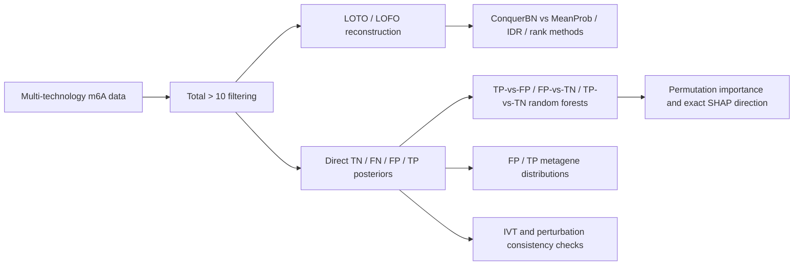

# SURF 2026: ConquerNet benchmarking and technology-error modelling

This repository is a compact, reproducible record of the final analysis route used in the SURF project. It contains analysis code, small audit tables, summary metrics and figures. Raw sequencing data, fitted model objects, per-site posterior files and OOF prediction objects are intentionally excluded.

## Analysis overview



The evidence chain deliberately separates internal signal reconstruction, model-derived error classes, feature-dependent discrimination, positional patterns and external consistency checks.

## Result figures


**Performance overview.** Circles denote AUROC and squares denote AUPRC. Panels **a** and **b** compare ConquerBN with four baseline integration methods using 14 held-out technologies and five independent held-out families, respectively. Panel **c** summarizes the completed direct-posterior random-forest tasks. Values are descriptive macro averages; detailed per-unit metrics and QC tables are retained in the corresponding analysis modules. [Source data](figures/source_data/readme_summary_metrics.csv) | [R plotting code](figures/code/plot_readme_summary.R) | [Vector PDF](figures/readme_results_summary.pdf)


**Posterior-derived FP/TP metagene profiles.** Curves show the eight technologies meeting the teacher-approved running threshold on a standardized 5′UTR–CDS–3′UTR axis. Small FP groups, particularly m6A-SAC and DeepRM, remain exploratory and are interpreted cautiously. [Effect sizes and QC](analysis/04_metagene/results/effect_sizes/) | [R plotting code](analysis/04_metagene/code/06_plot_fp_tp_standard_metagene.R)

## Final analysis scope

### 1. Leave-one-technology-out (LOTO)

- Retrain ConquerBN after removing one technology.
- Apply `Total > 10` to every retained technology-site observation before fitting.
- Define held-out labels with the held-out technology BBmix MAP call:
  `m6ASiteProb > 0.5` versus `<= 0.5`, also requiring held-out `Total > 10`.
- Compare ConquerBN, MeanProb, RankProduct, RRA and continuous IDR on one common evaluation domain.
- Vote is excluded.

### 2. Leave-one-family-out (LOFO)

- Hold out one complete technology family and retrain on the other four families.
- Use the same BBmix MAP and `Total > 10` definition for each held-out technology.
- First average technologies within each family; the five held-out families are the independent comparison units.

### 3. Direct four-class posterior machine learning

- Use the no-IVT-calibration, IVT-matched full ConquerBN model.
- Directly reconstruct joint posteriors for `TN=(R0,T0)`, `FN=(R1,T0)`, `FP=(R0,T1)` and `TP=(R1,T1)`.
- Call each class using class-specific global FDR `<0.05`; keep unique calls only.
- Require technology-specific `Total > 10`; do not use MAP/Viterbi fallback.
- Run a task when both compared classes contain more than 50 sites (`min_reliable=51`).
- Use 185 OmicsFeatures, chromosome-blocked five-fold OOF validation, 300-tree random forests and permutation importance.

### 4. FP/TP metagene and SHAP direction

- Compare posterior-derived FP and TP locations on a standardized 5′UTR–CDS–3′UTR axis for eight eligible technologies.
- Use exact random-forest reconstruction before SHAP; the saved OOF probabilities must be reproduced to numerical equality before directional interpretation.

## Key results

### LOTO: five-method common domain, all 14 technologies

| Method | Macro AUROC | Macro AUPRC |
|---|---:|---:|
| ConquerBN | **0.7873** | **0.6785** |
| MeanProb | 0.7812 | 0.6510 |
| IDR | 0.7178 | 0.6032 |
| RRA | 0.6912 | 0.5307 |
| RankProduct | 0.6776 | 0.5234 |

### LOFO: five independent held-out families

| Method | Family-macro AUROC | Family-macro AUPRC |
|---|---:|---:|
| ConquerBN | **0.7679** | **0.6638** |
| MeanProb | 0.7488 | 0.6233 |
| IDR | 0.6709 | 0.5664 |
| RRA | 0.6585 | 0.5033 |
| RankProduct | 0.6414 | 0.4921 |

These are held-out signal-reconstruction benchmarks, not external biological truth.

### Direct-posterior RF screening

| Task | Completed technologies | Macro AUROC | Macro AUPRC |
|---|---:|---:|---:|
| TP vs FP | 8 | 0.8938 | 0.9529 |
| FP vs TN | 7 | 0.7988 | 0.3163 |
| TP vs TN | 11 | 0.9319 | 0.7676 |

All 26 completed models passed OOF row-index, missing-value and probability-range checks. The feature export contains 26 model-specific Top20 tables (520 rows). `meta_tx_topology` was stable in 8/8 TP-vs-FP models and 7/7 FP-vs-TN models.

### Positional and external consistency analyses

- FP/TP metagene patterns were technology-specific rather than uniformly shifted.
- m6A-SAC (62 FP) and DeepRM (236 FP) meet the teacher-approved running threshold but remain small-minority analyses and require cautious interpretation.
- The MeRIP IVT 2-of-3 endpoint did **not** preferentially support the model-derived TP class: IVT-positive rates were 11.4% for TP and 16.7% for FP. This is retained as an important negative result, not hidden.
- Perturbation responsiveness was contrast-dependent and did not provide a universal TP-over-FP advantage.
- Exact SHAP reconstruction completed for 11 core TP-vs-FP/FP-vs-TN models; maximum raw and corrected OOF reproduction error was zero, and 105/110 inspected feature directions were stable across at least four folds.

## Proposed integrative displays

These are next-step visualization designs enabled by the deposited results; they have not yet been generated and should not be confused with completed analyses.

1. **Technology evidence landscape** — place each technology by held-out reconstruction performance and FP-vs-TN learnability, with point size showing FP count and colour showing technology family. This would reveal which technologies are both recoverable from orthogonal evidence and associated with predictable error structure.
2. **Technology error atlas** — one card per technology combining four-class counts, task-specific AUROC/AUPRC, leading SHAP directions and the FP/TP metagene curve. This would preserve technology-specific patterns that disappear in a single macro-average.
3. **Evidence-ladder figure** — connect LOTO/LOFO reconstruction, posterior class calling, feature-based discrimination, transcript-position patterns and IVT/perturbation validation in one figure. Positive and negative external findings should be shown together.

## Repository map

```text
analysis/
  01_loto_lofo/             final Total>10 LOTO/LOFO + IDR benchmark
  02_external_validation/   no-cali MeRIP IVT and perturbation analyses
  03_direct_posterior_ml/   four-class global-FDR labels and RF screening
  04_metagene/              eight-technology FP/TP metagene analysis
  05_shap_direction/        exact RF reconstruction and SHAP directions
docs/                       frozen protocols and concise reports
data_catalogue/             input-object metadata and internal path catalogue
```

## Data availability

The repository does not redistribute the ConquerNet benchmark RDS objects, IVT/perturbation datasets, fitted EM models, IDR matrices or OmicsFeatures object. See [`DATA_AVAILABILITY.md`](DATA_AVAILABILITY.md) for the required object contracts.

## Important interpretation boundary

`TP`, `FP`, `FN` and `TN` are ConquerBN posterior-derived internal classes unless an analysis explicitly references IVT or perturbation data. They must not be described as experimentally verified truth. Likewise, high AUROC describes ranking discrimination; it does not by itself establish probability calibration.

## Software

The analyses use R with `SummarizedExperiment`, `GenomicRanges`, `S4Vectors`, `bnlearn`, `matrixStats`, `extraDistr`, `ranger`, `pROC`, `PRROC`, `fastshap`, `dplyr`, `tidyr` and `ggplot2`.

## Release status

This is a public research snapshot of the finalized SURF analysis workflow. It is intended to make the computational route, compact audit evidence and current findings reviewable without redistributing the underlying sequencing data or fitted model objects. Results remain subject to supervisor/collaborator review and should not be treated as a final manuscript release.
