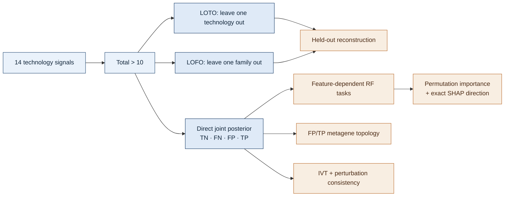

<h1 align="center">SURF 2026 · ConquerNet Evidence & Reliability Atlas</h1>

<p align="center">
  <strong>Benchmarking multi-technology m6A integration, posterior-derived error states,<br>
  genomic feature signatures and independent biological consistency</strong>
</p>

<p align="center">
  <code>2,788,705 sites</code> · <code>14 technologies</code> · <code>5 families</code> ·
  <code>Total &gt; 10</code> · <code>no-IVT-calibration labels</code>
</p>

> [!IMPORTANT]
> This repository is a compact evidence record, not a data dump. It contains
> executable analysis code, small audit tables, summary results, figures and the
> SURF poster. Raw sequencing objects, fitted models, per-site posterior matrices
> and OOF prediction vectors remain on the project server.

<p align="center">
  
</p>

## Why this project exists

m6A technologies do not observe the same biochemical signal in the same way.
ConquerNet integrates orthogonal technologies in a hierarchical Bayesian model;
this project asks not only whether that integration reconstructs held-out signal,
but also **where and why individual technologies disagree with the integrated
model**.

The analysis therefore follows an evidence ladder rather than treating one AUROC
as the whole story:



## Analysis at a glance

| Evidence layer | Question | Frozen definition | Status |
|---|---|---|---|
| LOTO | Can 13 technologies reconstruct the 14th? | Held-out BBmix MAP, `Total>10`, common method domain | Complete: 14 folds |
| LOFO | Can four technology families reconstruct the fifth? | Family-level retraining and five independent family units | Complete: 5 folds |
| Four-class posterior | What is the joint model support for TN/FN/FP/TP? | Class-specific global FDR `<0.05`, unique calls, no fallback | Complete: 14 technologies |
| Feature models | Are reliability/error states feature-dependent? | 185 features, chromosome-blocked 5-fold OOF, both classes `>50` | Complete: 26 models |
| Direction | Which feature values move predictions toward TP or FP? | Exact RF reconstruction before SHAP | Complete: 11 core models |
| Metagene | Do FP and TP occupy different transcript regions? | Standardized 5′UTR–CDS–3′UTR axis, both classes `>50` | Complete: 8 technologies |
| External consistency | Are TP calls more IVT-supported or perturbation-responsive? | no-cali TP/FP labels; study-matched contrasts | Complete, mixed/negative evidence retained |

## Frozen analysis contract

### Held-out benchmarks

- **LOTO:** remove one technology, apply `Total>10` to retained evidence,
  retrain ConquerBN and evaluate against the held-out technology's BBmix MAP
  call (`m6ASiteProb>0.5` versus `<=0.5`, also `Total>10`).
- **LOFO:** remove one complete technology family and retrain on the other four;
  average technology metrics within family and treat the five families as the
  independent units.
- Compare ConquerBN, MeanProb, Rank Product, RRA and matching continuous IDR on
  one common site domain. Vote is excluded.

### Direct four-class posterior

For root state `R`, family Strategy state `S`, technology state `T` and evidence
`e`:

```text
P(R=r,T=t|e) = sum_s P(R=r,S=s|e) × P(T=t,S=s|e) / P(S=s|e)
```

| `R` | `T` | Class | Code |
|---:|---:|---|---:|
| 0 | 0 | TN | 0 |
| 1 | 0 | FN | 1 |
| 0 | 1 | FP | 2 |
| 1 | 1 | TP | 3 |

Each class is called separately with local error `1-P(class)` and cumulative
global FDR `<0.05`. Only sites selected for exactly one class are retained,
followed by technology-specific `Total>10`. There is **no MAP/Viterbi fallback**.
The model is run only when both task classes contain more than 50 sites
(`min_reliable=51`).

The no-IVT-calibration, IVT-matched full model is used here so later IVT
comparisons do not reuse IVT-derived calibration information.

## Key results

### Held-out reconstruction

| Design | Method | AUROC | AUPRC |
|---|---|---:|---:|
| LOTO, 14 technologies | **ConquerBN** | **0.7873** | **0.6785** |
|  | MeanProb | 0.7812 | 0.6510 |
|  | IDR | 0.7178 | 0.6032 |
|  | RRA | 0.6912 | 0.5307 |
|  | Rank Product | 0.6776 | 0.5234 |
| LOFO, 5 families | **ConquerBN** | **0.7679** | **0.6638** |
|  | MeanProb | 0.7488 | 0.6233 |
|  | IDR | 0.6709 | 0.5664 |
|  | RRA | 0.6585 | 0.5033 |
|  | Rank Product | 0.6414 | 0.4921 |

These are held-out signal-reconstruction benchmarks, not external biological
truth.

### Direct-posterior feature screening

| Task | Completed technologies | Macro AUROC | Macro AUPRC |
|---|---:|---:|---:|
| TP vs FP | 8 | 0.8938 | 0.9529 |
| FP vs TN | 7 | 0.7988 | 0.3163 |
| TP vs TN | 11 | 0.9319 | 0.7676 |

All 26 completed models passed OOF row-identity, missing-value and probability
range checks. The feature export contains 26 model-specific Top-20 tables (520
rows). `meta_tx_topology` was stable in 8/8 TP-vs-FP models and 7/7 FP-vs-TN
models.

> [!CAUTION]
> AUPRC follows positive-class prevalence. m6A-SAC (62 FP) and DeepRM (236 FP)
> enter under the approved `>50` rule, but their TP-vs-FP AUPRC values are
> dominated by extreme TP prevalence and must be interpreted beside AUROC and
> class counts.

## Technology-specific transcript topology

<p align="center">
  
</p>

The eight eligible technologies show distinct rather than universal FP/TP
shifts. Figure counts are the subset with valid metagene coordinates, so they can
be slightly smaller than RF-domain counts. [Effect sizes and QC](analysis/04_metagene/results/effect_sizes/)
· [plotting code](analysis/04_metagene/code/06_plot_fp_tp_standard_metagene.R)

## External consistency: negative findings are evidence too

- The MeRIP IVT 2-of-3 endpoint did **not** preferentially support model-derived
  TP: IVT-positive rates were 11.4% for TP and 16.7% for FP.
- Writer/eraser perturbation response was contrast-dependent and did not show a
  universal TP-over-FP advantage.
- These results are retained rather than filtered away; IVT and perturbation are
  independent consistency evidence, not perfect ground truth.

## SURF poster

<p align="center">
  <a href="poster/SURF2026_Poster.pptx">
    
  </a>
</p>

The poster presents the full group project. This repository concentrates on the
benchmarking, posterior-error modelling, feature interpretation and validation
components. [Open the poster folder](poster/).

## Repository map

```text
analysis/
  01_loto_lofo/             final Total>10 LOTO/LOFO + IDR benchmark
  02_external_validation/   no-cali MeRIP IVT and perturbation analyses
  03_direct_posterior_ml/   direct four-class global-FDR labels + RF screening
  04_metagene/              eight-technology FP/TP transcript topology
  05_shap_direction/        exact RF reconstruction + SHAP directions
data_catalogue/             final input paths and object contracts
docs/                       frozen protocol and review reports
figures/                    README performance figure and source data/code
poster/                     SURF poster source and GitHub preview
```

Start with the module READMEs:

1. [LOTO/LOFO](analysis/01_loto_lofo/README.md)
2. [External validation](analysis/02_external_validation/README.md)
3. [Direct posterior and ML](analysis/03_direct_posterior_ml/README.md)
4. [Metagene](analysis/04_metagene/README.md)
5. [SHAP direction](analysis/05_shap_direction/README.md)

## Reproducibility and data

- Exact execution order and constants: [`REPRODUCIBILITY.md`](REPRODUCIBILITY.md)
- Frozen final protocol: [`docs/FINAL_PROTOCOL.md`](docs/FINAL_PROTOCOL.md)
- Final input/output provenance: [`data_catalogue/FINAL_DATA_PATHS.csv`](data_catalogue/FINAL_DATA_PATHS.csv)
- Object contracts and exclusions: [`DATA_AVAILABILITY.md`](DATA_AVAILABILITY.md)
- Release audit: [`docs/CODE_REVIEW_SNAPSHOT_20260827.md`](docs/CODE_REVIEW_SNAPSHOT_20260827.md)

## Interpretation boundary

`TP`, `FP`, `FN` and `TN` are ConquerBN posterior-derived internal classes unless
an analysis explicitly references IVT or perturbation data. They are not
experimentally verified truth. Likewise, high AUROC measures discrimination; it
does not by itself demonstrate calibrated real-world probability.

---

<p align="center">
  <strong>SURF 2026 · Supervisor: Dr. Zhen Wei</strong><br>
  <sub>Compact public research snapshot · results remain subject to collaborator review</sub>
</p>
