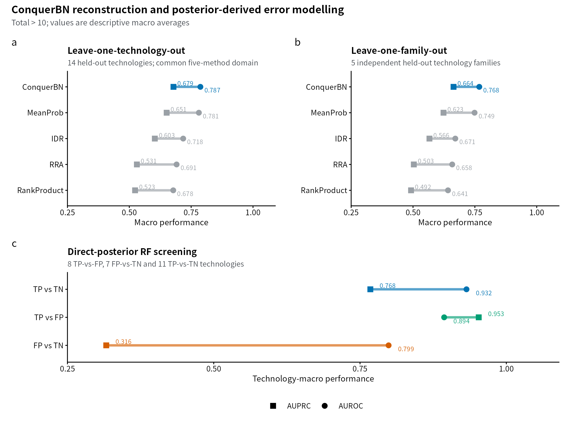
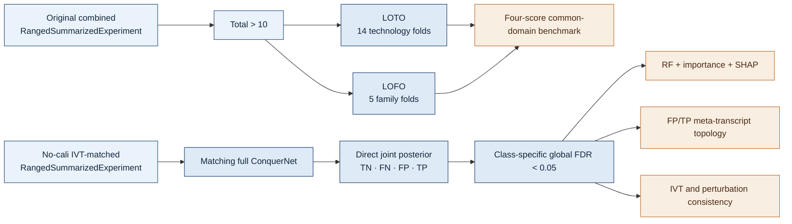
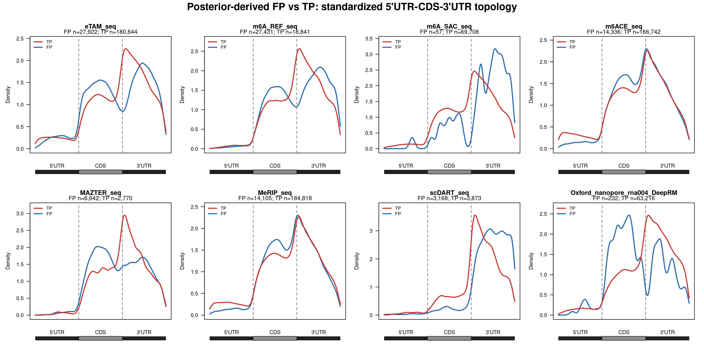
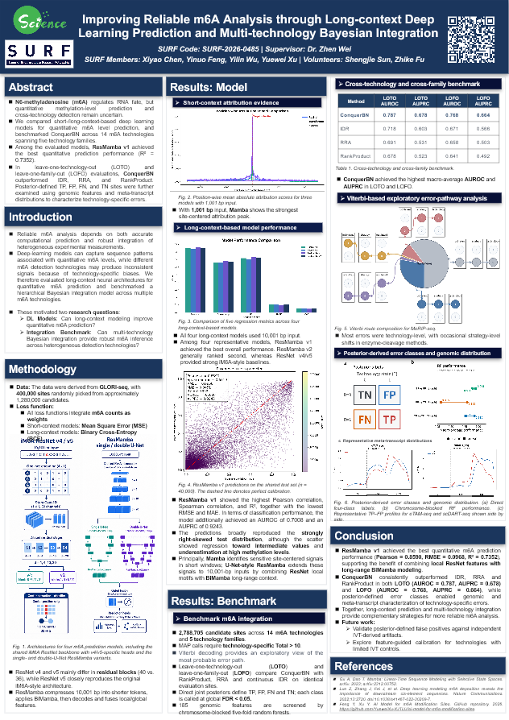

<h1 align="center">SURF 2026 · ConquerNet Benchmarking & Posterior Error Atlas</h1>

<p align="center">
  <strong>Held-out reconstruction across m6A technologies, direct joint-posterior<br>
  error states, and feature-dependent reliability</strong>
</p>

<p align="center">
  <code>2,788,705 sites</code> · <code>14 technologies</code> ·
  <code>5 technology families</code> · <code>Total &gt; 10</code>
</p>

> [!IMPORTANT]
> Two related but distinct data branches are used. LOTO/LOFO use the original
> combined benchmark and held-out single-technology BBmix MAP labels. The
> four-class/RF branch uses the IVT-matched **no-calibration** dataset and its
> matching full ConquerNet model, so IVT-derived calibration information is not
> reused when those labels are compared with IVT evidence.

> [!NOTE]
> **ConquerNet** names the integrated model/workflow. **ConquerBN** is the
> frozen method label used for its held-out root-posterior score in result
> tables and figures.

<p align="center">
  
</p>

## Step-by-step guide

Start with the public archive; full model reproduction additionally requires
research objects that are not distributed here.

1. Install Git and Python 3.10+, then download the repository in a terminal:

   ```bash
   git clone https://github.com/Ci-yo/SURF-2026-ConquerNet-Benchmarking.git
   cd SURF-2026-ConquerNet-Benchmarking
   ```

2. Check the retained files and benchmark summaries:

   ```bash
   python scripts/check_public_snapshot.py
   ```

   Success reports `Public snapshot checks passed` and prints 11 summary rows.
   No R packages, GPU or private RDS inputs are needed for this check.

3. Open the [summary CSV](figures/source_data/readme_summary_metrics.csv),
   then inspect [per-fold LOTO results](analysis/01_loto_lofo/results/LOTO/per_fold_metrics.csv)
   and [per-family LOFO results](analysis/01_loto_lofo/results/LOFO/per_family_method_summary.csv).

4. Follow [Getting started](docs/GETTING_STARTED.md) to redraw the summary
   figure, understand each output, or configure the full analysis.

5. Before a full rerun, read [data availability](DATA_AVAILABILITY.md).
   The original combined benchmark and the no-calibration IVT-matched branch
   are distinct inputs. Internal server paths are provenance records, not
   public download locations.

The checksum check validates the public snapshot; it does not refit ConquerNet
or regenerate per-site labels. The detailed guide includes prerequisites,
execution order and troubleshooting for each reproduction level.

## Scientific question

m6A technologies measure different biochemical signals and cannot be treated
as interchangeable observations of perfect biological truth. This project asks
two connected questions:

1. **Held-out reconstruction:** can the remaining technologies reconstruct a
   technology, or an entire technology family, that was excluded from model
   training?
2. **Internal error structure:** when a technology agrees or disagrees with the
   integrated model, are those posterior-derived states associated with stable
   genomic and transcriptomic features?

The first question is addressed by LOTO/LOFO. The second starts from a direct
four-state joint posterior, then uses random forests, feature importance, SHAP
direction and transcript-topology analyses.



## Final analysis scope

| Layer | Primary question | Frozen definition | Status |
|---|---|---|---|
| LOTO | Can 13 technologies reconstruct the 14th? | Held-out BBmix MAP, `Total>10`, four-score common domain | 14 folds complete |
| LOFO | Can four families reconstruct the fifth? | Family-out retraining; five family-level units | 5 folds complete |
| Four-class posterior | What is the joint support for TN/FN/FP/TP? | Class-specific global FDR `<0.05`, unique call, no fallback | 14 technologies complete |
| RF screening | Are internal reliability/error states feature-dependent? | 185 predictors, chromosome-blocked 5-fold OOF, both classes `>50` | 26 models complete |
| SHAP direction | Which feature values shift a model toward its positive class? | Exact RF/OOF reconstruction before SHAP | 11 core models complete |
| Meta-transcript | Do model-derived FP and TP occupy different transcript regions? | Standardized 5′UTR-CDS-3′UTR axis, FP and TP both `>50` | 8 technologies complete |
| External consistency | Are TP calls more IVT-supported or perturbation-responsive? | Independent, study-matched evidence; not benchmark truth | Exploratory analyses complete |

## Data objects and what their values mean

The same number can be a count, probability, rank score or class code depending
on the object. These terms are kept separate throughout the repository.

| Object or field | Actual R representation | Statistical meaning | Use |
|---|---|---|---|
| Combined benchmark | `RangedSummarizedExperiment`, 2,788,705 × 14 | Aligned genomic sites × technologies | LOTO/LOFO input |
| `m6A`, `Total` assays | `double matrix`, 2,788,705 × 14 | Read-count values stored in R's numeric matrix type | Coverage filtering and emissions |
| `m6ASiteProb` assay | `double matrix` in `[0,1]` or `NA` | Single-technology BBmix foreground posterior; **not** ConquerNet `TrueM6A` | Held-out MAP label at `>0.5` |
| `AdjPvalue` assay | `double matrix` in `[0,1]` or `NA` | Binomial-test BH-adjusted P value; not BBmix MAP and not posterior global FDR | Retained in input, not final held-out truth |
| ConquerNet holdout output | Numeric vector in `[0,1]` | `P_holdout(TrueM6A=1 | retained evidence)` | ConquerBN AUROC/AUPRC score |
| IDR files | Numeric `rowmin`; logical `idx` and `label` vectors | Primary continuous score is `-rowmin`; binary files are coverage/call auxiliaries | Continuous LOTO/LOFO comparator |
| Rank Product / RRA | Numeric rank-derived vectors | Relative ranking evidence, not probabilities | LOTO/LOFO comparators |
| Direct four-class posterior | Four numeric probabilities per technology-site pair | `P(R=r,T=t | all evidence)` for TN/FN/FP/TP; four values sum to one | High-confidence class calling |
| Final four-class matrix | `integer matrix`, 2,788,705 × 14 | `0=TN`, `1=FN`, `2=FP`, `3=TP`; uncalled sites are missing | RF and metagene labels |
| OmicsFeatures | `GRanges`, 2,788,705 ranges, 224 metadata columns | Genomic/transcript feature annotations; 185 columns enter screening | RF predictors |
| RF OOF output | Numeric raw and prevalence-corrected prediction scores | Positive-class output from an OOF classifier | AUROC/AUPRC ranking; not formal probability calibration |

Full object contracts and verified server paths are documented in
[`data_catalogue/OBJECT_CONTRACTS.md`](data_catalogue/OBJECT_CONTRACTS.md) and
[`data_catalogue/FINAL_DATA_PATHS.csv`](data_catalogue/FINAL_DATA_PATHS.csv).

## Frozen benchmark definitions

### LOTO: leave one technology out

- Remove one technology completely.
- Apply `Total>10` to retained technology-site evidence and retrain ConquerNet
  on the other 13 technologies.
- Evaluate against the held-out technology's BBmix MAP label:
  `m6ASiteProb>0.5` versus `<=0.5`, also restricted to held-out `Total>10`.
- Compare ConquerBN, continuous IDR, RRA and Rank Product on exactly the same
  sites. MeanProb and Vote are not included in the frozen Week10 comparison.

### LOFO: leave one technology family out

- Remove one complete family and retrain on the other four families.
- Evaluate every held-out technology against its own BBmix MAP label.
- Average technology metrics within the held-out family.
- Treat the five families, not the 14 technologies, as the independent units.
- Use matching family-out IDR rather than technology-out IDR.

### Direct TN/FN/FP/TP posterior

For root state `R`, family Strategy state `S`, technology state `T` and all
observed evidence `e`:

```text
P(R=r,T=t | e) = sum_s P(R=r,S=s | e) × P(T=t,S=s | e) / P(S=s | e)
```

| `R` | `T` | Class | Stored code |
|---:|---:|---|---:|
| 0 | 0 | TN | 0 |
| 1 | 0 | FN | 1 |
| 0 | 1 | FP | 2 |
| 1 | 1 | TP | 3 |

Each class is called separately using local error `1-P(class | e)` and a
cumulative posterior global FDR strictly below `0.05`. A site receives a label
only when exactly one class passes; technology-specific `Total>10` is then
applied. There is no marginal-threshold shortcut and no MAP/Viterbi fallback.

## Main results

### Held-out reconstruction

| Design | Method | Macro AUROC | Macro AUPRC |
|---|---|---:|---:|
| LOTO, 14 technologies | **ConquerBN** | **0.7873** | **0.6785** |
|  | IDR | 0.7178 | 0.6032 |
|  | RRA | 0.6912 | 0.5307 |
|  | Rank Product | 0.6776 | 0.5234 |
| LOFO, 5 families | **ConquerBN** | **0.7679** | **0.6638** |
|  | IDR | 0.6709 | 0.5664 |
|  | RRA | 0.6585 | 0.5033 |
|  | Rank Product | 0.6414 | 0.4921 |

ConquerBN ranks first in both the technology-level LOTO benchmark and the more
stringent family-level LOFO benchmark. These results measure reconstruction of
held-out technology signals; they are not direct biological ground truth.

### Direct-posterior RF screening

| Task | Complete technologies | Macro AUROC | Macro AUPRC |
|---|---:|---:|---:|
| TP vs FP | 8 | 0.8938 | 0.9529 |
| FP vs TN | 7 | 0.7988 | 0.3163 |
| TP vs TN | 11 | 0.9319 | 0.7676 |

All 26 completed models passed OOF row-identity, missing-value and score-range
checks. The feature export contains 26 model-specific Top-20 tables (520
rows). `meta_tx_topology` recurs in 8/8 TP-vs-FP models and 7/7 FP-vs-TN
models.

> [!CAUTION]
> AUPRC follows positive-class prevalence. m6A-SAC (62 FP) and DeepRM (236 FP)
> pass the approved `>50` rule, but their TP-vs-FP AUPRC values are dominated by
> extreme TP prevalence. Interpret AUPRC together with AUROC and class counts.

## FP-versus-TP transcript topology

<p align="center">
  
</p>

Eight technologies contain more than 50 called FP and TP sites. Their density
curves show technology-specific rather than universal shifts across standardized
5′UTR, CDS and 3′UTR regions. Figure counts use the subset with valid
meta-transcript coordinates and can therefore be slightly smaller than RF task
counts. [Effect sizes and QC](analysis/04_metagene/results/effect_sizes/) ·
[plotting code](analysis/04_metagene/code/06_plot_fp_tp_standard_metagene.R)

## Supporting external-consistency analyses

IVT and writer/eraser perturbation analyses are retained as independent
consistency checks, not as the LOTO/LOFO label source and not as perfect truth.
The current results are mixed rather than uniformly validating model-derived TP:

- MeRIP IVT 2-of-3 positive rates were 11.4% for TP and 16.7% for FP.
- Perturbation response was contrast-dependent and did not show a universal
  TP-over-FP advantage.

Keeping these negative findings visible prevents the internal four-class labels
from being overstated as experimentally verified truth.

## SURF poster

<p align="center">
  <a href="poster/SURF2026_Poster.pptx">
    
  </a>
</p>

The poster presents the full group project. This repository concentrates on the
benchmarking, posterior-error modelling, feature interpretation and validation
components. [Open the poster folder](poster/).

## Repository map

```text
analysis/
  01_loto_lofo/             final four-score Total>10 LOTO/LOFO benchmark
  02_external_validation/   no-cali MeRIP IVT and perturbation checks
  03_direct_posterior_ml/   direct four-class global-FDR labels + RF screening
  04_metagene/              eight-technology FP/TP transcript topology
  05_shap_direction/        exact RF reconstruction + SHAP direction
data_catalogue/             verified object contracts and server provenance
docs/                       frozen protocol and release audit
figures/                    README summary figure, R code and source CSV
poster/                     complete SURF poster and preview
```

Module entry points:

1. [LOTO/LOFO](analysis/01_loto_lofo/README.md)
2. [External consistency](analysis/02_external_validation/README.md)
3. [Direct four-class posterior and RF](analysis/03_direct_posterior_ml/README.md)
4. [Meta-transcript analysis](analysis/04_metagene/README.md)
5. [SHAP direction](analysis/05_shap_direction/README.md)

## Reproducibility

- Execution order and constants: [`REPRODUCIBILITY.md`](REPRODUCIBILITY.md)
- Frozen analysis protocol: [`docs/FINAL_PROTOCOL.md`](docs/FINAL_PROTOCOL.md)
- Data types and statistical meanings: [`data_catalogue/OBJECT_CONTRACTS.md`](data_catalogue/OBJECT_CONTRACTS.md)
- Exact server paths: [`data_catalogue/FINAL_DATA_PATHS.csv`](data_catalogue/FINAL_DATA_PATHS.csv)
- Release audit: [`docs/CODE_REVIEW_SNAPSHOT_20260827.md`](docs/CODE_REVIEW_SNAPSHOT_20260827.md)

## Interpretation boundary

`TP`, `FP`, `FN` and `TN` are ConquerNet posterior-derived internal classes
unless an analysis explicitly invokes IVT or perturbation data. A posterior
probability is a model quantity, a MAP label is a thresholded decision, an IDR
or rank score is a ranking statistic, and an RF OOF score is a classifier
output. None should be relabelled as experimentally verified truth without an
independent validation endpoint.

---

<p align="center">
  <strong>SURF 2026 · Supervisor: Dr. Zhen Wei</strong><br>
  <sub>Compact public research snapshot · results remain subject to collaborator review</sub>
</p>
